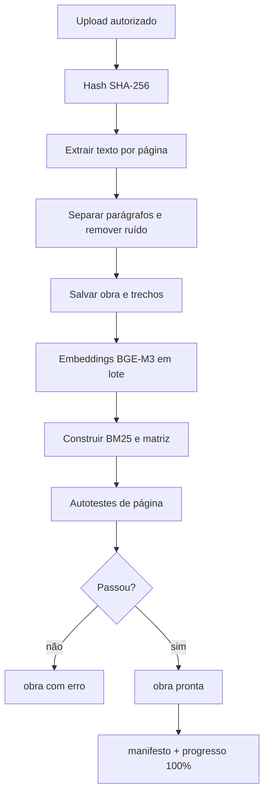
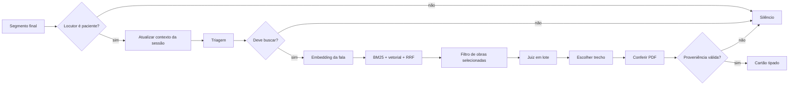

# Arquitetura do copiloto do Limmiar

O contrato e a sequência de integração vigentes estão em `plano-implementacao-limmiar.md`. As métricas abaixo são históricas e não validam a versão atual. A inferência consentida permanece local; a API hospedada recebe dados cifrados.

## Resumo direto

O copiloto não vai “treinar um modelo com cada PDF”. O PDF entra no acervo do RAG. O modelo é baixado uma vez, carregado no servidor e reutilizado para todas as sessões.

O fluxo é:

1. o profissional escolhe os livros permitidos para a sessão;
2. o cliente envia cada segmento final da transcrição para o servidor;
3. o servidor mantém uma janela curta de contexto por sessão;
4. o servidor gera o vetor e faz busca híbrida no acervo escolhido;
5. o juiz local reordena os melhores trechos;
6. o código confere página, parágrafo e texto diretamente no PDF;
7. somente então o serviço local devolve todas as referências aprovadas, tipadas e vinculadas à fala; não escolhe apenas a de maior score.

O juiz escolhido é o `gte-multilingual-reranker-base`, da Alibaba-NLP, afinado com pares de fala e trecho do domínio do Limmiar. O artefato existente no MVP está em `modelos/juiz-local/gte-r2`. A base original tem 306 milhões de parâmetros, suporta mais de 70 idiomas e até 8.192 tokens; é um reranker encoder, não um gerador de texto. O modelo original é Apache-2.0. [Modelo oficial do juiz](https://huggingface.co/Alibaba-NLP/gte-multilingual-reranker-base)

Há três funções separadas:

- `BAAI/bge-m3` encontra candidatos no acervo.
- `gte-multilingual-reranker-base` decide se fala e trecho realmente correspondem.
- o código escolhe e verifica a citação.

## Resultado medido até agora

O benchmark atual de 200 casos separados do treino encontra a página correta em 97% dos casos quando conserva os 200 candidatos. Porém, o fluxo final atual, usando apenas 10 candidatos no juiz local, gerou cartão com página correta em 9,5% dos casos e parágrafo exato em 5%. A latência final foi p50 de 806 ms e p95 de 1.299,7 ms.

Conclusão: a base está pronta para integração técnica, mas o portão de 90% ainda não está aprovado. O problema principal é o recall do juiz, não a citação.

## Stack escolhida

| Parte | Escolha do MVP | Onde roda | O que fica salvo |
|---|---|---|---|
| Transcrição | engine existente do Limmiar | cliente ou servidor | segmentos com tempo e locutor |
| API de IA | FastAPI + Python | servidor | nenhum estado clínico global |
| Leitura de PDF | `pypdf` | worker de ingestão | texto por página e parágrafo |
| Embedding | `BAAI/bge-m3` | inferência, GPU ou CPU | vetor de 1.024 dimensões por trecho |
| Busca lexical | BM25 com `rank_bm25` | inferência | índice lexical por versão |
| Busca híbrida | cosseno + BM25 + RRF | inferência | ranking de candidatos |
| Tradução auxiliar | Opus-MT em CTranslate2 int8 | inferência | modelos convertidos |
| Triagem | regressão logística sobre BGE-M3 | inferência | pesos e limiares versionados |
| Juiz | GTE afinado | inferência | checkpoint `gte-r2` ou posterior |
| Proveniência | `pypdf` + regras determinísticas | API | página, parágrafo e hash do PDF |
| Banco do MVP | SQLite + `numpy` | servidor | obras, trechos e vetores |
| Banco de escala | PostgreSQL + pgvector | servidor | mesma informação em escala |
| Armazenamento | volume de objetos versionado | cloud ou disco local | PDFs, índices e modelos |

### Por que não usar uma LLM grande no caminho principal

O problema é recuperação e classificação, não geração aberta. Uma LLM grande pode inventar autor, página ou parágrafo. Aqui a resposta só aponta para trecho que existe no PDF. Uma LLM maior pode explicar um cartão verificado no futuro, mas não deve ser a fonte da referência.

### Por que não fazer LoRA/QLoRA agora

LoRA/QLoRA ajusta pesos; não substitui o acervo, o índice ou a verificação da página. O primeiro ganho esperado vem de mais candidatos, melhores pares de treino, negativos difíceis e reranking em lote. Um novo adapter só entra se vencer `gte-r2` no mesmo teste e dentro do p95. Adapter e modelo-base devem ser armazenados juntos no manifesto.

## Onde cada coisa fica

```text
limmiar/
├─ apps/app/                         cliente React/TypeScript
│  ├─ envia segmentos de transcrição
│  ├─ recebe cartões e status
│  └─ deixa o profissional selecionar obras
├─ apps/api/                         API .NET
│  ├─ autentica o profissional
│  ├─ autoriza sessão e acervo
│  ├─ cria/fecha sessão do copiloto
│  └─ encaminha eventos para Python
├─ mvp-copiloto/                     serviço Python do MVP
│  ├─ src/copiloto/api.py            HTTP de inferência e ingestão
│  ├─ src/copiloto/ingestao.py       PDF → trechos → vetores → índice
│  ├─ src/copiloto/busca.py          busca híbrida
│  ├─ src/copiloto/treinado.py       triagem e juiz
│  ├─ src/copiloto/decisao.py        cartão ou silêncio
│  ├─ data/                          avaliações e metadados
│  ├─ data/pdfs/                     PDFs do acervo
│  ├─ indices/                       matrizes e índices lexicais
│  └─ modelos/                       modelos e checkpoints
└─ storage externo                   backup e migração
```

O cliente não carrega BGE-M3, o juiz ou o banco vetorial. Só envia eventos e renderiza o resultado.

## Download e carregamento

### Embedding: `BAAI/bge-m3`

O BGE-M3 é multilíngue, tem dimensão 1.024, janela de até 8.192 tokens e licença MIT. [Modelo oficial BGE-M3](https://huggingface.co/BAAI/bge-m3)

Baixar em uma máquina de build:

```powershell
hf download BAAI/bge-m3 --revision <commit-fixado> --local-dir modelos/hf/bge-m3
```

Carregar no worker:

```python
from sentence_transformers import SentenceTransformer

embedder = SentenceTransformer("modelos/hf/bge-m3", device="cuda")
vetores = embedder.encode(textos, normalize_embeddings=True)
```

Em produção, a pasta é volume somente leitura. O manifesto guarda o hash completo do commit. O Hugging Face documenta `hf download --local-dir` e o carregamento de pasta local. [Download versionado](https://huggingface.co/docs/huggingface_hub/en/guides/download) · [Carregamento local](https://huggingface.co/docs/transformers/main/en/models)

### Juiz: modelo-base e checkpoint afinado

```powershell
hf download Alibaba-NLP/gte-multilingual-reranker-base `
  --revision <commit-fixado> `
  --local-dir modelos/hf/gte-multilingual-reranker-base
```

O checkpoint que responde em produção deve ser completo:

```text
modelos/juiz-local/gte-r2/
├─ torch/
│  ├─ config.json
│  ├─ model.safetensors
│  ├─ tokenizer.json
│  └─ tokenizer_config.json
├─ treino.json
├─ limiares.json
└─ manifesto.json
```

Carregar uma vez no startup:

```python
from transformers import AutoModelForSequenceClassification, AutoTokenizer

tokenizer = AutoTokenizer.from_pretrained("modelos/juiz-local/gte-r2/torch")
model = AutoModelForSequenceClassification.from_pretrained(
    "modelos/juiz-local/gte-r2/torch",
    local_files_only=True,
    torch_dtype="auto",
)
model.eval()
```

Cada consulta envia pares `(fala, trecho)` em lote. Não se carrega o modelo por frase.

### Tradução auxiliar: Opus-MT + CTranslate2

A tradução não é necessária para o embedding multilíngue. Ela existe para dar ao BM25 equivalentes em `pt-BR`, `es` e `en-US`. Deve ser pulada se o texto já estiver no idioma do índice.

O CTranslate2 converte Transformers/Marian/OPUS-MT para um diretório binário e permite `int8`. [Conversão oficial](https://opennmt.net/CTranslate2/conversion.html) · [Guia OPUS-MT](https://opennmt.net/CTranslate2/guides/opus_mt.html)

```powershell
ct2-opus-mt-converter `
  --model_dir modelos/hf/opus-mt-en-ROMANCE `
  --output_dir modelos/ct2/opus-mt-en-ROMANCE `
  --quantization int8
```

Se a tradução estiver lenta, o sistema continua com BGE-M3 + BM25 no idioma original. Tradução é otimização, não barreira de correção.

## Ingestão de um PDF

Enviar PDF não treina o juiz. O pipeline é:



Cada trecho conserva:

```json
{
  "id": "trecho_01",
  "obraId": "obra_01",
  "pdfSha256": "...",
  "pagina": 10,
  "paragrafo": 4,
  "texto": "...",
  "idioma": "pt-BR",
  "embeddingModelo": "BAAI/bge-m3@<commit>",
  "indiceVersao": "indice-2026-09-29-001"
}
```

Status da UI:

```text
recebido → extraindo → indexando → testando → pronto
                                      └────→ erro
```

## Fluxo dentro de cada transcrição



O contexto não vira banco global. Cada sessão tem `sessionId`, janela de turnos recentes e `obrasIds`. Se a seleção estiver vazia, usa o acervo permitido daquele profissional; nunca mistura profissionais.

## Contratos

### Evento recebido pelo copiloto

```json
{
  "sessionId": "sessao_123",
  "segmentId": "segmento_456",
  "sequence": 42,
  "speaker": "patient",
  "text": "Eu fico em alerta quando vejo um homem desse lado da rua.",
  "language": "pt-BR",
  "startMs": 182400,
  "endMs": 185700,
  "selectedWorkIds": ["obra_01", "obra_07"]
}
```

### Cartão devolvido

```json
{
  "sessionId": "sessao_123",
  "segmentId": "segmento_456",
  "status": "match",
  "channel": "general",
  "confidence": 0.93,
  "phenomenon": "hipervigilância relacionada a medo",
  "source": {
    "workId": "obra_01",
    "title": "Título do artigo",
    "author": "Autor, A.",
    "page": 10,
    "paragraph": 4,
    "quote": "Texto literal conferido no PDF",
    "pdfSha256": "..."
  },
  "models": {
    "embedder": "BAAI/bge-m3@<commit>",
    "judge": "gte-r2",
    "index": "indice-2026-09-29-001"
  },
  "timingMs": {
    "embedding": 0,
    "retrieval": 0,
    "judge": 0,
    "provenance": 0,
    "total": 0
  }
}
```

Valores de `status`: `silent`, `clarify`, `match`, `risk`, `error`. `source` é obrigatório em `match` e `risk`; nunca existe cartão com página, parágrafo ou citação ausentes.

## Implementação no Limmiar

### Fase 1 — contratos e fronteira

Criar no TypeScript os tipos do evento e do cartão. O módulo de sessão publica `TranscriptSegmentFinalized`; ele não conhece BGE-M3, juiz ou SQLite. O cliente recebe `CopilotInsightCreated`.

Arquivos planejados:

```text
packages/copilot/src/contracts.ts
packages/copilot/src/session-adapter.ts
packages/copilot/src/machine.ts
apps/app/src/copilot/CopilotCard.tsx
apps/app/src/copilot/useSessionCopilot.ts
```

### Fase 2 — servidor e autorização

Adicionar no `apps/api`:

```text
POST /sessions/{sessionId}/copilot/start
POST /sessions/{sessionId}/copilot/segments
GET  /sessions/{sessionId}/copilot/insights
PUT  /sessions/{sessionId}/copilot/library
```

O .NET valida profissional, sessão e `selectedWorkIds`. Python só recebe IDs já autorizados.

### Fase 3 — serviço Python

Manter `mvp-copiloto` como processo separado. A primeira integração chama a API HTTP existente. No startup ele deve:

1. ler o manifesto do índice;
2. validar hashes;
3. carregar BGE-M3;
4. carregar triagem;
5. carregar juiz;
6. carregar tradutores;
7. carregar o índice;
8. marcar `/health/ready`.

Em cada segmento: validar, atualizar estado, ignorar terapeuta, triar, buscar somente obras autorizadas, julgar em lote, verificar proveniência e devolver cartão ou silêncio.

### Fase 4 — seleção por profissional

Persistir a seleção e criar snapshot na abertura:

```text
professional_library(professional_id, work_id, enabled, updated_at)
session_library_snapshot(session_id, work_id, index_version)
```

Alterar a biblioteca durante a sessão não muda a busca no meio da transcrição.

### Fase 5 — portão de qualidade

O deploy só passa com, por idioma e canal:

- recall de página ≥ 0,90;
- cartão com página correta ≥ 0,90;
- parágrafo correto ≥ 0,90 quando exigido;
- precisão de cartão ≥ 0,90;
- citação literal conferida = 1,00;
- p95 dentro do SLO.

O CI falha se qualquer piso ficar abaixo do mínimo.

### Fase 6 — escala

Para poucas sessões, um FastAPI com modelos aquecidos basta. Para centenas ou milhares:

- separar API leve de workers de inferência;
- fazer microbatch de embedding e juiz;
- manter uma cópia do modelo por GPU, não uma por sessão;
- manter estado curto em Redis ou serviço de sessão;
- manter PDFs e modelos em storage de objetos;
- migrar SQLite/numpy para PostgreSQL/pgvector quando a medição exigir;
- usar fila para ingestão e treino, não para atrasar cada segmento.

FastAPI trata replicação, memória, inicialização e reinício como decisões separadas de deployment. [Conceitos oficiais](https://fastapi.tiangolo.com/deployment/concepts/)

## Checklist de operação

- manifesto identifica hashes do PDF, modelo, juiz, índice e código;
- produção não baixa modelos silenciosamente;
- `/health/ready` só responde após aquecimento;
- sessão não consulta `workId` não autorizado;
- toda referência existe no PDF indicado;
- seleção vazia usa apenas acervo permitido;
- benchmark de 200 casos é reproduzível por seed;
- resultados de `pt-BR`, `es` e `en-US` ficam separados;
- artefato anterior existe para rollback;
- portão de 90% passou.

## Decisão final

Para o MVP, manter `bge-m3 + BM25 + RRF + gte-r2 + verificação determinística`, servidos por FastAPI e chamados pelo `apps/api`. Não colocar modelo no navegador e não treinar a cada upload. Primeiro integrar contratos, sessão e seleção de obras; em paralelo, aumentar candidatos e melhorar o juiz até o benchmark real atingir os pisos.
