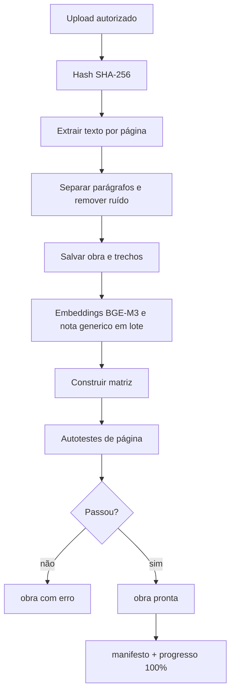
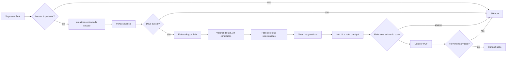

# Arquitetura do copiloto do Limmiar

O contrato e a sequência de integração vigentes estão em `plano-implementacao-limmiar.md`. As métricas abaixo são históricas e não validam a versão atual. A inferência consentida permanece local; a API hospedada recebe dados cifrados.

## Resumo direto

O copiloto não vai “treinar um modelo com cada PDF”. O PDF entra no acervo do RAG. O modelo é baixado uma vez, carregado no servidor e reutilizado para todas as sessões.

O fluxo é:

1. o profissional escolhe os livros permitidos para a sessão;
2. o cliente envia cada segmento final da transcrição para o servidor;
3. o servidor mantém uma janela curta de contexto por sessão;
4. o servidor dá o alerta de risco e pergunta ao juiz se o paciente fala de si (`vivencia`);
5. o servidor gera o vetor da fala e busca 24 candidatos no acervo escolhido;
6. os trechos que a preparação marcou como genéricos (`generico` acima do corte) saem;
7. o juiz dá a cada um dos outros a nota `principal`, e o maior vira cartão se passar do corte;
8. o código confere página, parágrafo e texto diretamente no PDF;
9. somente então o serviço devolve no máximo um cartão por fala, tipado e vinculado a ela.

O juiz é o `juiz-pequeno-v1` (`copiloto/juiz_pequeno.py`): um cross-encoder mmBERT-small destilado, exportado em ONNX e quantizado, que roda na CPU no mesmo processo da busca. Um logit por par responde a quatro perguntas, conforme o par: (fala, trecho) dá `principal`; (pergunta, trecho) dá `generico`; (fala, pergunta) dá `vivencia` e `risco`. As perguntas ficam em `data/juiz-pequeno.json` e os cortes no registro `data/juiz-v2/registro.jsonl`.

Há quatro funções separadas:

- `BAAI/bge-m3` encontra candidatos no acervo com a fala. Tradução e BM25 saíram: no gabarito não mudaram a âncora no top-40 (81/100 com ou sem eles).
- a nota `generico`, calculada uma vez por trecho na preparação, tira os parágrafos que só definem ou listam.
- o juiz decide se fala e trecho correspondem, e o corte decide se a resposta é confiável.
- o código escolhe e verifica a citação.

## Resultado medido até agora

As medições de cada versão ficam no registro (`data/juiz-v2/registro.jsonl`). Os cortes do `juiz-pequeno-v1` ainda serão medidos no gabarito; as linhas das cascatas e do Laya ficam como histórico.

## Stack escolhida

| Parte | Escolha do MVP | Onde roda | O que fica salvo |
|---|---|---|---|
| Transcrição | engine existente do Limmiar | cliente ou servidor | segmentos com tempo e locutor |
| API de IA | FastAPI + Python | servidor | nenhum estado clínico global |
| Leitura de PDF | `pypdf` | worker de ingestão | texto por página e parágrafo |
| Embedding | `BAAI/bge-m3` em ONNX int8 | processo do copiloto (CPU) | vetor de 1.024 dimensões por trecho |
| Busca | cosseno da fala | inferência | ranking de candidatos |
| Risco | cabeça linear sobre o vetor bge-m3 da fala | processo do copiloto (CPU) | pesos e corte em `data/risco-cabeca.json` |
| Juiz | `juiz-pequeno-v1`, cross-encoder mmBERT-small em ONNX Runtime | processo do copiloto (CPU) | `modelos/juiz-pequeno`; nota `generico` por trecho; cortes no registro da versão |
| Proveniência | `pypdf` + regras determinísticas | API | página, parágrafo e hash do PDF |
| Banco do MVP | SQLite + `numpy` | servidor | obras, trechos e vetores |
| Banco de escala | PostgreSQL + pgvector | servidor | mesma informação em escala |
| Armazenamento | volume de objetos versionado | cloud ou disco local | PDFs, índices e modelos |

### Por que o juiz só dá uma nota

O problema é recuperação e classificação, não geração aberta. Um modelo que gera pode inventar autor, página ou parágrafo. Aqui o juiz só dá uma probabilidade por par, sobre trechos que existem no PDF.

## Onde cada coisa fica

```text
limmiar/
├─ apps/app/                         cliente React/TypeScript
│  ├─ envia segmentos de transcrição
│  ├─ recebe cartões e status
│  └─ deixa o profissional selecionar obras
├─ apps/api/                         API .NET
│  ├─ autentica o profissional
│  ├─ autoriza sessão e acervo
│  ├─ cria/fecha sessão do copiloto
│  └─ encaminha eventos para Python
├─ mvp-copiloto/                     serviço Python do MVP
│  ├─ src/copiloto/api.py            HTTP de inferência e ingestão
│  ├─ src/copiloto/ingestao.py       PDF → trechos → vetores → índice
│  ├─ src/copiloto/busca.py          busca híbrida
│  ├─ src/copiloto/juiz_pequeno.py   juiz: vivência, genérico, principal e risco, no processo
│  ├─ src/copiloto/risco.py          alerta de risco
│  ├─ src/copiloto/decisao.py        cartão ou silêncio
│  ├─ data/                          avaliações e metadados
│  ├─ data/pdfs/                     PDFs do acervo
│  ├─ indices/                       matrizes e índices lexicais
│  └─ modelos/                       modelos e checkpoints
└─ storage externo                   backup e migração
```

O cliente não carrega BGE-M3, o juiz ou o banco vetorial. Só envia eventos e renderiza o resultado.

## Download e carregamento

### Embedding: `BAAI/bge-m3`

O BGE-M3 é multilíngue, tem dimensão 1.024, janela de até 8.192 tokens e licença MIT. [Modelo oficial BGE-M3](https://huggingface.co/BAAI/bge-m3)

O serviço roda a exportação ONNX int8 de `Xenova/bge-m3` (`onnx/sentence_transformers_int8.onnx`, que já devolve
`sentence_embedding`) no ONNX Runtime, na CPU, sem torch, com corte em 512 tokens. `scripts/baixar_modelos.py` baixa
`tokenizer.json` e o ONNX para `modelos/bge-m3` (ou `COPILOTO_EMBEDDER_DIR`) na revisão fixada em `embedder.py`:

```powershell
.venv/Scripts/python.exe scripts/baixar_modelos.py
```

`embedder.PADRAO` nomeia arquivo e revisão e vai gravado com cada vetor; vetores de outro codificador não carregam e são
recalculados. [Download versionado](https://huggingface.co/docs/huggingface_hub/en/guides/download)

### Juiz pequeno

A pasta `modelos/juiz-pequeno` (ou `COPILOTO_JUIZ_DIR`) traz `tokenizer.json` e `onnx/model_gather.onnx` (ou o arquivo de `COPILOTO_JUIZ_ONNX`). Uma sessão do ONNX Runtime, na CPU, carrega na primeira chamada e serve todas as threads; o aquecimento da API faz essa chamada:

```python
from copiloto import juiz_pequeno

juiz_pequeno.vivencia("fala do paciente")
juiz_pequeno.principal("fala do paciente", ["trecho 1", "trecho 2"])
juiz_pequeno.generico(["trecho 1", "trecho 2"])
```

Os pares vão em lotes de até 8, ordenados por tamanho, cortados em 320 tokens só no segundo texto; uma fala com mais de 160 tokens fica com a cabeça.

## Ingestão de um PDF

Enviar PDF não treina o juiz. O pipeline é:



Cada trecho conserva:

```json
{
  "id": "trecho_01",
  "obraId": "obra_01",
  "pdfSha256": "...",
  "pagina": 10,
  "paragrafo": 4,
  "texto": "...",
  "idioma": "pt-BR",
  "embeddingModelo": "BAAI/bge-m3@<commit>",
  "indiceVersao": "indice-2026-09-29-001"
}
```

Status da UI:

```text
recebido → extraindo → indexando → testando → pronto
                                      └────→ erro
```

## Fluxo dentro de cada transcrição



O contexto não vira banco global. Cada sessão tem `sessionId`, janela de turnos recentes e `obrasIds`. Se a seleção estiver vazia, usa o acervo permitido daquele profissional; nunca mistura profissionais.

## Contratos

### Evento recebido pelo copiloto

```json
{
  "sessionId": "sessao_123",
  "segmentId": "segmento_456",
  "sequence": 42,
  "speaker": "patient",
  "text": "Eu fico em alerta quando vejo um homem desse lado da rua.",
  "language": "pt-BR",
  "startMs": 182400,
  "endMs": 185700,
  "selectedWorkIds": ["obra_01", "obra_07"]
}
```

### Cartão devolvido

```json
{
  "sessionId": "sessao_123",
  "segmentId": "segmento_456",
  "status": "match",
  "channel": "general",
  "confidence": 0.93,
  "phenomenon": "hipervigilância relacionada a medo",
  "source": {
    "workId": "obra_01",
    "title": "Título do artigo",
    "author": "Autor, A.",
    "page": 10,
    "paragraph": 4,
    "quote": "Texto literal conferido no PDF",
    "pdfSha256": "..."
  },
  "models": {
    "embedder": "BAAI/bge-m3@<commit>",
    "judge": "juiz-pequeno-v1",
    "index": "indice-2026-09-29-001"
  },
  "timingMs": {
    "embedding": 0,
    "retrieval": 0,
    "judge": 0,
    "provenance": 0,
    "total": 0
  }
}
```

Valores de `status`: `silent`, `clarify`, `match`, `risk`, `error`. `source` é obrigatório em `match` e `risk`; nunca existe cartão com página, parágrafo ou citação ausentes.

## Implementação no Limmiar

### Fase 1 — contratos e fronteira

Criar no TypeScript os tipos do evento e do cartão. O módulo de sessão publica `TranscriptSegmentFinalized`; ele não conhece BGE-M3, juiz ou SQLite. O cliente recebe `CopilotInsightCreated`.

Arquivos planejados:

```text
packages/copilot/src/contracts.ts
packages/copilot/src/session-adapter.ts
packages/copilot/src/machine.ts
apps/app/src/copilot/CopilotCard.tsx
apps/app/src/copilot/useSessionCopilot.ts
```

### Fase 2 — servidor e autorização

Adicionar no `apps/api`:

```text
POST /sessions/{sessionId}/copilot/start
POST /sessions/{sessionId}/copilot/segments
GET  /sessions/{sessionId}/copilot/insights
PUT  /sessions/{sessionId}/copilot/library
```

O .NET valida profissional, sessão e `selectedWorkIds`. Python só recebe IDs já autorizados.

### Fase 3 — serviço Python

Manter `mvp-copiloto` como processo separado. A primeira integração chama a API HTTP existente. No startup ele deve:

1. ler o manifesto do índice;
2. validar hashes;
3. carregar BGE-M3;
4. carregar o juiz pequeno e conferir os cortes da versão;
5. carregar o índice;
6. marcar `/health/ready`.

Em cada segmento: validar, atualizar estado, ignorar terapeuta, dar o alerta de risco, passar pelo portão, buscar somente obras autorizadas, tirar os genéricos, dar a nota principal, aplicar o corte, verificar proveniência e devolver cartão ou silêncio.

### Fase 4 — seleção por profissional

Persistir a seleção e criar snapshot na abertura:

```text
professional_library(professional_id, work_id, enabled, updated_at)
session_library_snapshot(session_id, work_id, index_version)
```

Alterar a biblioteca durante a sessão não muda a busca no meio da transcrição.

### Fase 5 — portão de qualidade

O deploy só passa com, por idioma e canal:

- recall de página ≥ 0,90;
- cartão com página correta ≥ 0,90;
- parágrafo correto ≥ 0,90 quando exigido;
- precisão de cartão ≥ 0,90;
- citação literal conferida = 1,00;
- p95 dentro do SLO.

O CI falha se qualquer piso ficar abaixo do mínimo.

### Fase 6 — escala

Para poucas sessões, um FastAPI com modelos aquecidos basta. Para centenas ou milhares:

- separar API leve de workers de inferência;
- fazer microbatch de embedding e juiz;
- manter uma cópia do modelo por GPU, não uma por sessão;
- manter estado curto em Redis ou serviço de sessão;
- manter PDFs e modelos em storage de objetos;
- migrar SQLite/numpy para PostgreSQL/pgvector quando a medição exigir;
- usar fila para ingestão e treino, não para atrasar cada segmento.

FastAPI trata replicação, memória, inicialização e reinício como decisões separadas de deployment. [Conceitos oficiais](https://fastapi.tiangolo.com/deployment/concepts/)

## Checklist de operação

- manifesto identifica hashes do PDF, modelo, juiz, índice e código;
- produção não baixa modelos silenciosamente;
- `/health/ready` só responde após aquecimento;
- sessão não consulta `workId` não autorizado;
- toda referência existe no PDF indicado;
- seleção vazia usa apenas acervo permitido;
- benchmark de 200 casos é reproduzível por seed;
- resultados de `pt-BR`, `es` e `en-US` ficam separados;
- artefato anterior existe para rollback;
- portão de 90% passou.

## Decisão final

Para o MVP, manter a busca densa `bge-m3`, o juiz pequeno no mesmo processo da busca, na CPU, e a verificação determinística, servidos por FastAPI e chamados pelo `apps/api`. Não colocar modelo no navegador e não treinar a cada upload. Uma versão nova do juiz entra pelo ciclo de `docs/juiz-ciclo-de-treino.md`.
