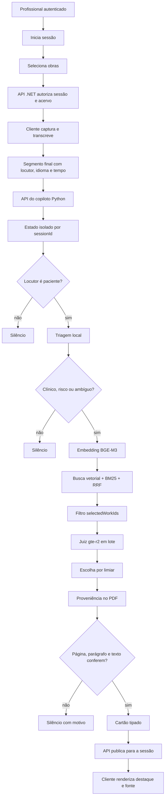
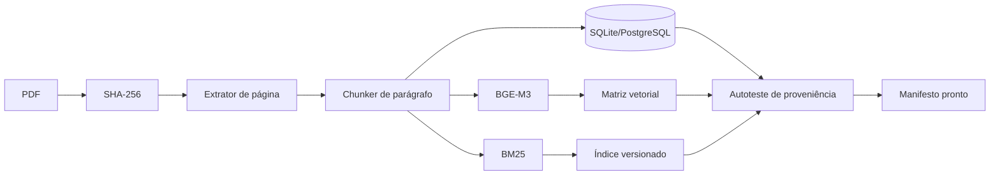

# Organograma do copiloto

## Visão completa



## Ingestão do acervo



## Ciclo de vida do índice

```text
PDF recebido
   ↓
obra em processamento
   ↓
trechos extraídos + páginas preservadas
   ↓
embeddings e BM25 gerados
   ↓
autotestes aprovados
   ↓
índice vN imutável
   ↓
sessões novas apontam para vN
```

Um índice não deve ser alterado enquanto uma sessão o usa. Um novo PDF gera uma nova versão; sessões existentes terminam na versão que já tinham.
